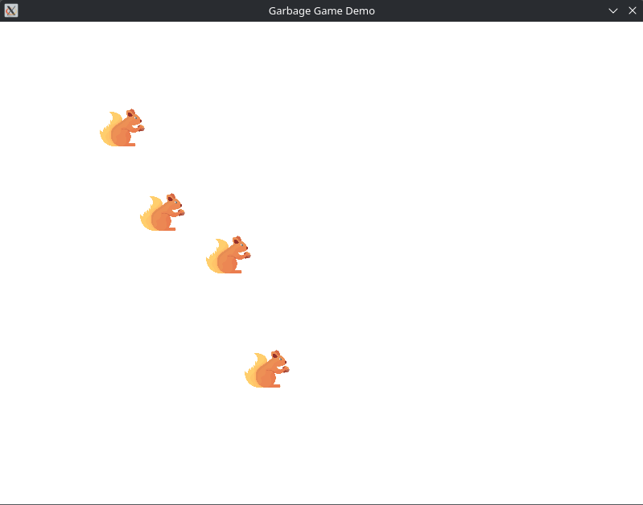

# Project02
A demo game for Project02 in Nicholas Seward's game programming class.

Each game object is constructed from components, which handle the coordinates, input, behavior, and textures.
The player has full (including diagonal) movement using WASD as input.
One enemy will follow the player, while another will run away from the player. Another will oscillate back and forth like the starter code.
Game objects are dynamically loaded from XML.
